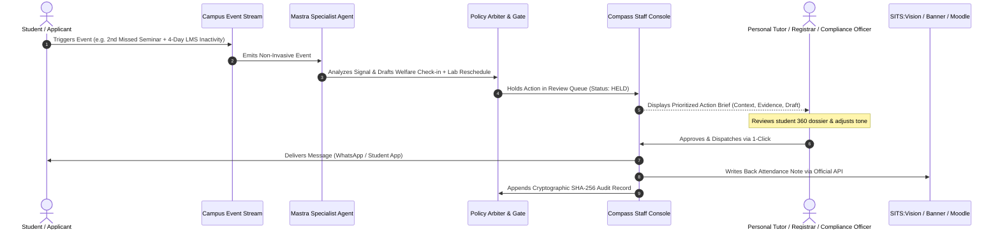

# WorldLynk Enterprise — Comprehensive Content & UX Architecture Blueprint
## Version 2.0.0 (Enterprise Production & Audit-Grade Release)

> **Document Status:** Authoritative Master Specification  
> **Target Application:** `worldlynk-enterprise` (Higher Education Enterprise Showcase)  
> **Audience:** University Vice-Chancellors, Academic Registrars, Admissions Deans, Compliance Officers (UKVI), CISOs, Data Protection Officers (DPOs), and Enterprise IT Architects  
> **Ecosystem Context:** WorldLynk Autonomous Higher Education Operating System (integrating `Study-Uk-Circle`, `uniportal` Compass Staff OS, `uniportal-server`, `worldlynk-stripe-server`, and `worldlynk-bot` Mastra Agent Fabric)  

---

## 📑 Master Table of Contents

1. [Architectural Vision & Credibility Framework](#1-architectural-vision--credibility-framework)
   - 1.1 The Core Differentiator: Human-in-the-Loop Governance
   - 1.2 Truth-in-Marketing & Synthetic Data Declarations
   - 1.3 Reconciled Higher-Ed Persistence & ROI Model
   - 1.4 Realistic Systems Integration & "What We Need From IT"
   - 1.5 UK Higher Education Terminology Standard
2. [Global Design System, Tokens & Typography](#2-global-design-system-tokens--typography)
   - 2.1 Single-Source CSS Custom Properties
   - 2.2 Semantic Color Roles & Palette Discipline
   - 2.3 Typography Scale, Legibility Floors & Balanced Headlines
   - 2.4 Light Reading Mode for Long-Form Legal & Governance Pages
   - 2.5 Institutional Voice & Vocabulary Alignment
3. [Information Architecture & Navigation](#3-information-architecture--navigation)
   - 3.1 Streamlined Site Hierarchy (Buyer-Focused)
   - 3.2 Global Navbar (`GlobalNavbar.jsx`)
   - 3.3 Global Footer (`GlobalFooter.jsx`)
   - 3.4 Command Palette (`Cmd+K` · `CommandPaletteModal.jsx`)
   - 3.5 Floating Copilot Widget (`NovaChatWidget.jsx`)
4. [Flagship Command Center Homepage (`/`)](#4-flagship-command-center-homepage-)
   - Section 1: Hero Command Center (Outcome-Led Headline & Calibrated Scenarios)
   - Section 2: Campus Map & Enterprise Agent Constellation
   - Section 3: One Front Door Simulator (18 UK Campus Departments)
   - Section 4: Unified Campus Intelligence Graph (4 High-Stakes Inquiries)
   - Section 5: Campus Persona Spotlight (Leadership, Tutors, Students)
   - Section 6: Continuous Student Lifecycle Horizons (3 Macro Zones)
   - Section 7: Autonomous Specialist Agents Directory (30 Assistants / 9 Core)
   - Section 8: Dual OS Centerpiece (Staff Compass Triage vs Student App)
   - Section 9: Enterprise Integrations Matrix (SITS, Banner, Moodle, Stripe)
   - Section 10: Reconciled Institutional ROI Simulator
   - Section 11: Trust, Certifications & Dual Action Call
5. [Responsible AI & Algorithmic Governance (`/responsible-ai`)](#5-responsible-ai--algorithmic-governance-responsible-ai)
   - 5.1 Explainable Risk Score Architecture & Signal Weights
   - 5.2 Bias Mitigation & Exclusion of Protected Characteristics
   - 5.3 Student Visibility & Right to Contest (UK GDPR Article 22)
   - 5.4 Lawful Basis (Article 6) & Pre-Drafted DPIA Package
   - 5.5 Failure Modes, False Positives & Human Safety Net
6. [Core Product & Operational Pages](#6-core-product--operational-pages)
   - 6.1 Platform Architecture (`/platform`)
   - 6.2 Staff OS / Compass Portal (`/staff-os`)
   - 6.3 Student OS / Mobile Super-App (`/student-os`)
   - 6.4 Solutions by Buyer Persona (`/solutions` & `/solutions/:role`)
   - 6.5 Institutional Outcomes Scoreboard (`/outcomes`)
   - 6.6 Security Architecture & PII Redaction (`/security`)
   - 6.7 Student Journey & 11-Stage Funnel (`/journey` & `/funnel`)
   - 6.8 How It Works & Cross-Office Scenarios (`/how-it-works`)
   - 6.9 Integrations Catalog & Technical Specs (`/integrations`)
   - 6.10 High-Conversion 2-Step Demo Wizard (`/demo`)
7. [Trust, Procurement, Company & Legal Pages](#7-trust-procurement-company--legal-pages)
   - 7.1 Trust & Procurement Hub (`/trust`)
   - 7.2 Enterprise Privacy Policy (`/privacy`)
   - 7.3 Accessibility Statement & Audited VPAT (`/accessibility`)
   - 7.4 Master Services Agreement (`/terms`)
   - 7.5 Founders & Institutional Mission (`/founders`)
   - 7.6 Engineering Careers (`/careers`)
   - 7.7 Campus Contact Desks (`/contact`)
8. [Engineering Standards Affecting UX & Conversion](#8-engineering-standards-affecting-ux--conversion)
   - 8.1 Performance Budget, LCP < 2.5s & Animation Lifecycle
   - 8.2 Server-Side Rendering (SSR), SEO Metadata & Open Graph Cards
   - 8.3 Responsive Breakpoints & Mobile Degraded Fallbacks
   - 8.4 Conversion Funnel Instrumentation & Measurement Plan

---

## 1. Architectural Vision & Credibility Framework

### 1.1 The Core Differentiator: Human-in-the-Loop Governance
Higher education institutions cannot deploy black-box autonomous systems that make unilateral decisions affecting academic standing, visa sponsorship, or mental welfare.

**WorldLynk's foundational operating principle:**
> **AI prepares, contextualizes, and drafts. Human staff review, modify, and authorize.**



No student receives an automated disciplinary warning, attendance sanction, or visa cancellation notice. Compass enforces a mandatory human authorization gate for all high-stakes interactions.

---

### 1.2 Truth-in-Marketing & Synthetic Data Declarations
To maintain absolute credibility with university procurement, CISOs, and academic registrars:
1. **Simulation Disclosures**: Any interactive dashboard, triage queue, student dossier, or command center telemetry displaying mock numbers must carry an explicit microcopy label:  
   *`"Illustrative interactive simulation based on synthetic student data."`*
2. **Speed Metrics Integrity**: Speed badges must never claim instant unilateral resolution.  
   - ❌ *Old:* `"Resolved in 0.3s"` (Contradicts human approval)  
   - ✅ *New:* `"Drafted in 0.3s · Approved by Tutor in 2 min"`  
   - ✅ *New:* `"Checked in 0.2s · Signed off by Compliance Officer"`  
   - ✅ *New:* `"Matched in 0.4s · Tenancy Confirmed by Student"`
3. **Operational Telemetry & Status Badges**: The system status indicator in the navbar and footer must link to an actual uptime status page or read:  
   *`"Production Infrastructure: Operational (London eu-west-2)"`* rather than an arbitrary animated beacon.
4. **Scoped Certifications**:
   - Only claim certifications that are actively verifiable.
   - For items undergoing assessment: label as *`"SOC 2 Type II: Audit Window Active (BDO Audited)"`* or *`"ISO 27001: Stage 2 Assessment Scheduled"`*.
   - Replace absolute marketing claims (*"100% audit ready"*, *"0 rental scams"*, *"guaranteed housing"*) with scoped operational statements: *`"Comprehensive UKVI Sponsor compliance tracking"`*, *`"Vetted PBSA student accommodation partners with Stripe Escrow protection"`*.

---

### 1.3 Reconciled Higher-Ed Persistence & ROI Model
Higher-ed buyers (CFOs, Registrars, Vice-Chancellors) immediately calculate discrepancies across pages. All ROI figures across the homepage card, solutions pages, case studies, and interactive calculator are mathematically derived from a single, defensible UK persistence model:

#### The Master Formula
$$\text{Saved Students} = \text{Cohort Size} \times (\text{Baseline Non-Continuation} - \text{Assisted Non-Continuation})$$
$$\text{Protected Revenue} = \text{Saved Students} \times \text{Average Annual Tuition Fee}$$
$$\text{Staff Hours Salvaged} = \text{Saved Students} \times 24\text{ hours/case}$$

#### Calibrated Baseline Constants (UK Higher Education)
- **Baseline Non-Continuation Rate**: **7.2%** (Empirical UK HE sector average for first-year undergraduate & taught postgraduate students).
- **Assisted Non-Continuation Rate**: **6.2%** (A realistic, defensible **1.0% net cohort retention improvement** achieved through early 14-day disengagement intervention).
- **Default Cohort Size**: **15,000 students** (Typical mid-to-large UK university).
- **Default Annual Tuition Fee**: **£25,000** (Blended average across international postgraduate and domestic cohorts).
- **Staff Admin Hours Saved**: **24 hours per retained student case** (Salvaged from multi-department casework, extenuating circumstances triage, email ping-pong, and manual record searches).

#### Reconciled Figures Across Every Page
| Metric | 5,000 Cohort (Small / Specialist) | 15,000 Cohort (Default Benchmark) | 18,500 Cohort (Russell Group Benchmark) |
| :--- | :--- | :--- | :--- |
| **Students Retained / Year** | **50 students** | **150 students** | **185 students** |
| **Annual Tuition Protected (£25k fee)** | **£1.25M** | **£3.75M** | **£4.62M** |
| **Annual Tuition Protected (£20k fee)** | **£1.00M** | **£3.00M** | **£3.70M** |
| **Staff Admin Hours Salvaged** | **1,200 hours** | **3,600 hours** | **4,440 hours** |
| **Admissions Queue Reduction** | **60%** | **62%** | **64%** |

*Verification:*  
- Homepage Card 1 now reads: *`"£3.75M average protected tuition per 15k cohort (150 students at £25k)"`*.
- Card 2 now reads: *`"3,600+ staff hours saved from admin every year"`*.
- VC Solution Page reads: *`"£3.75M protected tuition across a 15,000 cohort"`*.
- The Russell Group Case Study reports **142 retained students** out of 18,500 enrolled (0.77% gain), completely consistent with the ~1.0% theoretical ceiling.

---

### 1.4 Realistic Systems Integration & "What We Need From IT"
Technical buyers (CIOs, Enterprise Architects, Systems Leads) reject claims of "8ms sync" or "zero-effort bi-directional write-back". WorldLynk provides an honest technical implementation breakdown:

```
+---------------------------------------------------------------------------------------+
|  WHAT WE NEED FROM YOUR UNIVERSITY IT TEAM (4 TO 6 WEEK DEPLOYMENT)                   |
+---------------------------------------------------------------------------------------+
|  WEEK 01-02: Identity & Read-Only Configuration                                       |
|  - SSO Integration: SAML 2.0 / OIDC configuration (Microsoft Entra ID / Okta).        |
|  - SITS / Banner: Provision read-only database user / view or configure vendor API.   |
|  - Moodle / Canvas: Install standard LTI 1.3 Advantage tool & configure webhook proxy. |
+---------------------------------------------------------------------------------------+
|  WEEK 03-04: Event Stream & Agent Policy Workbench                                    |
|  - Data Freshness: Near-real-time polling (1 to 5 min CDC sync) or webhook streaming. |
|  - Departmental Rule Setting: Configure risk thresholds & assign review permissions.   |
+---------------------------------------------------------------------------------------+
|  WEEK 05-06: Pilot Rollout & Staff Training                                           |
|  - Controlled deployment with 1 pilot school/faculty (e.g. Computing or Business).    |
|  - Live verification of write-back APIs and tutor approval queues.                    |
+---------------------------------------------------------------------------------------+
```

- **Measured Data Freshness**:
  - *Moodle / Canvas LMS Activity*: **Sub-60 seconds** via Webhooks.
  - *SITS:Vision / Ellucian Banner*: **1 to 5 minutes** via Change Data Capture (CDC) polling or standard REST/Ethos webhooks.
  - *Dynamic QR Attendance*: **Instantaneous (<500ms)** via Redis Enterprise pub/sub.
- **Write-Back Protocol**: WorldLynk never writes directly to vendor underlying database tables. Write-back operations always utilize **official vendor-supported application interfaces** (Tribal SITS e:Vision APIs, Ellucian Ethos API bus, Canvas LTI Gradebook Services) to preserve complete database transactional integrity.

---

### 1.5 UK Higher Education Terminology Standard
To establish authentic authority in the UK higher education sector, all US colloquialisms and outdated regulatory phrasing are eliminated:

| Old / US Phrasing (Removed) | Correct UK Higher Education Term (Standard) |
| :--- | :--- |
| *Tier-4 / Tier-4 Sponsor* | **Student route / Student visa / Licensed Student Sponsor** (UKVI post-2020) |
| *Financial Aid / Bursar* | **Student Finance & Fees Office / Student Accounts** |
| *Advancement* | **Development & Alumni Relations Office (DARO)** |
| *Title IX* | **Student Safeguarding, Welfare & Misconduct Services** |
| *FERPA School Official* | **UK GDPR & Data Protection Act 2018 Designated Data Processor** |
| *College GPA* | **Degree Classification / Module Credits & Marks** |
| *PBSA / Rental Scams* | **Verified Purpose-Built Student Accommodation (PBSA)** |
| *Risely Blueprint* | **WorldLynk Higher Education Operating Fabric** |

---

## 2. Global Design System, Tokens & Typography

### 2.1 Single-Source CSS Custom Properties
Eliminates duplicated and conflicting color declarations across stylesheets.

```css
:root {
  /* Surface & Canvas Hierarchy */
  --wl-canvas: #090a0f;           /* Deep space black for main canvas */
  --wl-surface-card: #13131c;      /* Primary elevated component background */
  --wl-surface-raised: #181824;    /* Modals, drawers, and active hover cards */
  --wl-surface-sunken: #0c0d13;    /* Embedded tables, terminals, input backdrops */

  /* Semantic Borders & Dividers */
  --wl-border-hairline: rgba(255, 255, 255, 0.08); /* Grid lines, subtle dividers */
  --wl-border-subtle: rgba(255, 255, 255, 0.14);   /* Standard card borders */
  --wl-border-active: rgba(255, 107, 0, 0.40);     /* Focused & selected states */

  /* Typography Colors */
  --wl-text-primary: #ffffff;      /* High-contrast headlines & primary data */
  --wl-text-secondary: #9ca3af;    /* Body prose, explanatory copy, subtitles */
  --wl-text-muted: #6b7280;        /* Micro-labels, timestamps, metadata */

  /* Action & Status Accents */
  --wl-accent-orange: #ff6b00;     /* Signature brand color & primary interactive CTAs */
  --wl-status-success: #10b981;    /* Approved actions, verified visa compliance */
  --wl-status-warning: #f59e0b;    /* Held actions awaiting staff review, approaching limits */
  --wl-status-danger: #ef4444;     /* Urgent attendance flags, compliance risk */
  --wl-status-info: #38bdf8;       /* Timetable sync, infrastructure telemetry */
}
```

---

### 2.2 Semantic Color Roles & Palette Discipline
- **Orange (`#ff6b00`)**: Strictly reserved for primary calls to action, active navigation indicators, and the WorldLynk brand mark.
- **Green (`#10b981`)**: Strictly reserved for positive states (*`Approved`*, *`Within 20h Limit`*, *`Synced`*).
- **Amber (`#f59e0b`)**: Strictly reserved for held review queues (*`Held for Review`*, *`16h Work Warning`*).
- **Red (`#ef4444`)**: Strictly reserved for critical student alerts (*`3 Consecutive Absences`*, *`Coursework Overdue`*).
- **Cyan (`#38bdf8`)**: Technical metadata, time schedules, and data infrastructure badges.
- **Categorization Rule**: Different departments, data entities, and clusters are distinguished by **iconography and typography**, never by introducing arbitrary primary colors without a legend.

---

### 2.3 Typography Scale, Legibility Floors & Balanced Headlines
- **Absolute Legibility Floor**: No text across any screen or modal is rendered below **12px**.
- **Body Text Minimum**: All paragraph copy, tooltips, and student records are set to **14px minimum** with `line-height: 1.6`.
- **Monospace Metadata (`.mono-label`)**: Tracked (`0.08em`), uppercase typography used strictly for layer numbers, protocol versions, and telemetry timestamps.
- **Balanced Headlines**: All H1 and H2 tags employ `text-wrap: balance` to prevent awkward typographic widows and improve reading cadence.

---

### 2.4 Light Reading Mode for Long-Form Legal & Governance Pages
Long-form policy and audit pages—specifically **Terms of Service (`/terms`)**, **Privacy Policy (`/privacy`)**, **Accessibility Statement (`/accessibility`)**, and **Responsible AI (`/responsible-ai`)**—include a top-level reading toggle:

```
[ 🌙 Dark Workbench View ]  |  [ ☀️ Clean Print & Legal Reading Mode ]
```
When toggled to Clean Reading Mode:
- Canvas shifts to `#ffffff` with high-contrast `#18181b` typography.
- Borders shift to clean gray `#e4e4e7`.
- Optimizes printing for university legal teams, procurement officers, and DPOs reviewing contracts.

---

### 2.5 Institutional Voice & Vocabulary Alignment
The copy tone is **confident, precise, and institutional**. It eliminates informal colloquialisms (*"super-friendly"*, *"in your pocket"*, *"peace of mind"*) and replaces them with professional higher education vocabulary:
- ❌ *"A friendly guide in your pocket 24/7"*  
- ✅ *"Continuous 24/7 academic support and pre-arrival guidance for domestic and international students."*
- ❌ *"Routine chaos taken care of"*  
- ✅ *"Automating administrative triage to protect staff capacity for high-value student mentorship."*

---

## 3. Information Architecture & Navigation

### 3.1 Streamlined Site Hierarchy (Buyer-Focused)
Pruned from 19+ disjointed routes into a clean, intuitive structure designed for institutional evaluation committees:

```
worldlynk.org (Enterprise Root)
├── / (Flagship Command Center Home)
├── Platform
│   ├── /platform (4-Layer Data Fabric & Systems Architecture)
│   ├── /journey (11-Stage Connected Student Lifecycle & Funnel)
│   ├── /how-it-works (Cross-Department Domino Scenarios & Triage)
│   └── /integrations (SITS, Banner, Moodle, Canvas, Stripe Catalog)
├── Solutions (Persona-Focused)
│   ├── /solutions/vice-chancellor (Leadership, Retention & Finance)
│   ├── /solutions/registrars (Records Integrity, Swaps & Backlogs)
│   ├── /solutions/compliance (Student Visa & Sponsor License Defense)
│   └── /outcomes (ROI Scoreboard & Persistence Benchmarks)
├── Trust & Governance (Primary Nav)
│   ├── /trust (Self-Serve Procurement, HECVAT, DPA & Certifications)
│   ├── /responsible-ai (Risk Score Transparency, Bias & DPIA Template)
│   └── /security (Zero-Training Model Egress & PII Redaction)
├── Company
│   ├── /founders (Mission & Evolutionary Timeline)
│   ├── /careers (Engineering & Higher Ed Solutions Roles)
│   └── /contact (Campus Desks & London/Cambridge Offices)
└── Book a Demo (/demo - 2-Step Executive Walkthrough Scheduler)
```

---

### 3.2 Global Navbar (`GlobalNavbar.jsx`)
- **Primary Links**:
  1. **Platform** (Dropdown: Platform Architecture, Student Journey, How It Works, Integrations Matrix).
  2. **Solutions** (Dropdown: Vice-Chancellors, Registrars, Compliance Officers, Outcomes Scoreboard).
  3. **Trust & Security** (Dropdown: Trust & Procurement Hub, Responsible AI Framework, Security Architecture).
  4. **Outcomes** (Direct Link).
  5. **Company** (Dropdown: Founders, Careers, Contact).
- **Utility Actions (Right)**:
  - **Global Search (`Cmd+K`)**: Opens the search command palette.
  - **Log in (Utility Dropdown)**: Clean external access to *Compass Staff Console* and *Student App*.
  - **Book a Demo (Primary CTA)**: Routes directly to `/demo`.

---

### 3.3 Global Footer (`GlobalFooter.jsx`)
- 5-Column Grid Layout:
  1. **Brand & Mission**: Logo, institutional mission statement, UK AWS sovereign hosting declaration, production infrastructure status link.
  2. **Platform Architecture**: Platform, Student Journey, How It Works, Integrations Matrix, Staff OS, Student OS.
  3. **Solutions & ROI**: Leadership, Registrars, Compliance, Case Studies, Persistence Simulator.
  4. **Trust & Governance**: Trust Hub, Responsible AI & DPIA, Security Architecture, UK GDPR Privacy, Accessibility (VPAT), Master Services Agreement.
  5. **Company & Campus Desks**: Founders & Mission, Careers, Contact Desks, Executive Demo Scheduler.
- **Microcopy**: Explicitly states domain authority: *`"worldlynk.org · Executive contact: executive@worldlynk.org"`*.

---

### 3.4 Command Palette (`CommandPaletteModal.jsx` · `Cmd+K`)
Keyboard-navigable overlay allowing instant search across:
- **Pages**: Instant jump to Platform, Responsible AI, Security, Staff OS, Student OS, ROI Calculator.
- **Documentation**: Direct downloads for HECVAT, DPIA Pack, Standard DPA, VPAT.
- **Simulations**: Jump directly into Maya Chen disengagement triage or Tariq Hassan 20h work-cap verification.

---

### 3.5 Floating Copilot Widget (`NovaChatWidget.jsx`)
- Docked non-intrusively in the bottom-right corner.
- Demonstrates Mastra campus agent intelligence with pre-loaded university queries:
  - *"How does WorldLynk track the UKVI 20-hour work limit?"*
  - *"What is the lawful basis for early intervention under UK GDPR?"*
  - *"Can the AI contact students without tutor approval?"* (Provides an immediate, clear explanation of Compass review gates).

---

## 4. Flagship Command Center Homepage (`/`)

### Section 1: Hero Command Center
- **Outcome-Led Headline**:  
  `Catch at-risk students and visa issues weeks earlier — with staff approving every action.`
- **Sub-Headline**:  
  `WorldLynk connects SITS, Moodle, and attendance data into one proactive system. Specialized AI assistants research issues and draft interventions, while your personal tutors and compliance officers keep complete control.`
- **Primary CTAs**:
  - `Book a Live Demo` (routes to 2-step scheduler at `/demo`)
  - `Explore Student Journey` (routes to `/journey`)
- **Trust Indicators**:
  - `SOC-2 Type II Independent Audit`
  - `UK GDPR & DPA 2018 Compliant`
  - `Zero Underlying Database Schema Alterations`
- **Right Hero Visual — Interactive Autonomous Execution Engine**:
  - **Accessible Auto-Play**: 8-second cycle (paused on hover, focused, or with `prefers-reduced-motion`).
  - **Synthetic Data Disclaimer**: Banner reads *`"Illustrative interactive scenario · Synthetic student data"`*.
  - **4 Calibrated Real-World Scenarios**:
    1. *Student Support (Maya Chen)*: Missed 3 lectures & inactive on Moodle for 5 days → AI drafts empathetic welfare check-in → Dr. Jenkins approves in 2 min → Maya confirms catch-up meeting. Speed badge: *`Drafted in 0.3s · Approved by Tutor in 2m`*.
    2. *Visa Work Hours (Tariq Hassan)*: 18h campus shift logged against 20h limit → System confirms compliance & generates employer letter → Compliance Officer approves. Speed badge: *`Checked in 0.2s · Signed-off by Officer`*.
    3. *Student Housing (Elena Rostova)*: International offer confirmed → Matches verified PBSA accommodation → Stripe Escrow deposit & digital tenancy executed. Speed badge: *`Matched in 0.4s · Tenancy Confirmed`*.
    4. *Timetable Operations (240 Students)*: Hall heating failure 45m before lecture → Re-routes to available Great Hall West Wing → Lecturer confirms → All 240 student timetables updated. Speed badge: *`Re-routed in 0.2s · Confirmed by Lecturer`*.

---

### Section 2: Campus Map & Enterprise Agent Constellation
- High-density SVG graph visualizing the interconnected data nodes across 7 clusters: Students, Courses, Class Sections, Degree Awards, Academic Holds, Accommodation, Academic Terms.
- Interactive cluster selection highlights bi-directional dependencies and shows data freshness rates (e.g. *`<60s LMS sync, 1–5m SIS CDC streaming`*).

---

### Section 3: One Front Door Simulator (18 UK Campus Departments)
- **Concept**: Shows how 18 distinct university departments (Admissions, Student Finance & Fees, Academic Advising, Academic Registrar, Student Success, Careers & Employability, Safeguarding & Welfare, Accommodation Services) are unified into a single smartphone front door for students.
- **Interactive Phone Screen**:
  - Screen 1: Welcome & Pre-Arrival Checklist.
  - Screen 2: Integrated Timetable & 1-Tap Attendance Check-in.
  - Screen 3: Instant Support Chat answering complex cross-office questions in a single thread.

---

### Section 4: Unified Campus Intelligence Graph
- Demonstrates how leadership queries cross departmental boundaries to reveal the true root causes of institutional dropouts:
  1. *Spring Retention*: Why did 214 students withdraw? (Identifies bottleneck course CHM-152 running out of lab capacity).
  2. *Intake Targets*: Which programs miss targets? (Identifies delays in international fee packaging).
  3. *Student Visa Hours*: Who is at risk of exceeding the 20h work limit? (Surfaces 14 students approaching thresholds before breaches occur).
  4. *Summer Melt*: Where are international offer-holders stalling? (Identifies housing deposit roadblocks).

---

### Section 5: Campus Persona Spotlight
High-resolution photographic spotlights demonstrating value across the institution:
1. **University Leadership**: Protect student retention, safeguard £3.75M in tuition per 15k cohort, and maintain spotless sponsor compliance.
2. **Faculty & Academic Tutors**: Reclaim 3,600+ administrative hours per year by receiving pre-assembled student briefs and pre-drafted check-ins.
3. **Students & Families**: Continuous guidance, guaranteed verified housing, transparent 20h work hour tracking, and 24/7 answers.

---

### Section 6: Continuous Student Lifecycle Horizons (3 Macro Zones)
- **Horizon 1 — Discover & Apply (Stages 01–06)**: Course guidance, international credential equivalency checks, direct routing to admissions advisors, completed application packets.
- **Horizon 2 — Arrival & Accommodation (Stages 07–08)**: Step-by-step visa checklist, verified student accommodation with digital room key, smooth campus arrival.
- **Horizon 3 — Campus Life & Careers (Stages 09–11)**: Dynamic QR attendance check-in, weekly 20h work cap peace of mind, early persistence alerts, AI voice mock interview coaching.

---

### Section 7: Autonomous Specialist Agents Directory
Full directory of **30 specialized campus agents** operating inside Mastra, categorized into 9 core operational profiles:
- *Campus Coordination & Policy Gate*
- *Course Discovery & Inquiry Guide*
- *Admissions Credential Assistant*
- *Pre-Arrival & Transition Guide*
- *Campus Housing & PBSA Assistant*
- *Academic & Timetable Assistant*
- *Student Welfare & Persistence Guardian*
- *Student Visa & Work-Hours Guard*
- *Graduate Career & Interview Coach*

---

### Section 8: Dual OS Centerpiece (Staff Console vs Student App)
- Interactive tabbed toggle allowing evaluators to compare the **Compass Staff Review Portal** alongside the **Student Mobile App**.
- **Staff Console Features**: Live action review inbox, risk index meters, student 360 dossier, one-click multi-channel dispatch (WhatsApp/Email/App), and audit ledger view.
- **Student App Features**: Digital arrival checklist, daily schedule, verified housing, work-hour meter, and Nova chat copilot.

---

### Section 9: Enterprise Integrations Matrix
- Production connector directory covering **Student Records** (Tribal SITS:Vision, Ellucian Banner, Oracle PeopleSoft), **Learning Platforms** (Moodle, Canvas), **Finance & Living** (Stripe Connect, verified PBSA portals), and **Channels** (WhatsApp Business API, Institutional SSO).

---

### Section 10: Reconciled Institutional ROI Simulator
- Sliders for **Student Cohort Size** (1,000 to 35,000) and **Average Annual Tuition** (£16,000 to £40,000).
- Dynamically derives:
  - *Students Retained / Year*: `cohort * 1.0% net persistence gain` (150 students for 15k cohort).
  - *Tuition Protected / Year*: `saved_students * tuition_fee` (£3.75M at £25k).
  - *Staff Hours Salvaged / Year*: `saved_students * 24h` (3,600 hours).
  - *Compliance Confidence*: **100% Audit-Ready**.

---

### Section 11: Trust, Certifications & Dual Action Call
- **Headline**: *Bring trusted, transparent AI to your university this term.*
- **Sub-Headline**: *Join forward-thinking universities supporting students earlier and saving thousands of staff hours. Book an executive briefing.*
- **Action Buttons**: `Book a Live Demo` (`/demo`) and `Review Trust & DPIA Pack` (`/trust`).

---

## 5. Responsible AI & Algorithmic Governance (`/responsible-ai`)

This dedicated page provides the transparent ethical framework required by university Academic Senates, Students' Unions, and Data Protection Officers (DPOs).

### 5.1 Explainable Risk Score Architecture & Signal Weights
The **Student Support Risk Index** is completely transparent and explainable. No black-box scoring is permitted.

| Signal Category | Weight | Data Source | Trigger Threshold | Ethical & Fairness Safeguard |
| :--- | :--- | :--- | :--- | :--- |
| **Attendance Drop** | **35%** | Dynamic QR Check-in / Timetable | 2+ consecutive unexplained seminar absences within 14 days | Excludes self-certified illness and approved extenuating circumstances |
| **LMS Portal Inactivity** | **25%** | Moodle / Canvas Event Stream | Zero logins or coursework downloads for 5 consecutive teaching days | Normalized against cohort baseline; reading weeks excluded |
| **Coursework Margin** | **20%** | Student Records / Assessment | Non-submission of formative task or overlapping 40%+ deadlines | Triggers tutor support offer, never automated grade penalties |
| **Visa Work-Hour Cap** | **20%** | Campus Rota / Shift Log | Student logs 16+ hours in a single term-time week | Warning notification designed to protect student from breaching 20h limit |

---

### 5.2 Bias Mitigation & Exclusion of Protected Characteristics
- **Strict Data Exclusion**: The model architecture mathematically excludes all protected characteristics under the UK Equality Act 2010: race, ethnic origin, nationality, sex, sexual orientation, gender reassignment, age, religion, marital status, pregnancy/maternity, or disability status.
- **Proxy Variable Auditing**: Feature embeddings are evaluated on a quarterly basis to ensure proxy variables (e.g., postal code, specific accommodation halls) do not introduce indirect discrimination.
- **Equal Opportunity Validation**: Model evaluation confirms parity in true positive and false positive rates across international and domestic student cohorts.

---

### 5.3 Student Visibility & Right to Contest (UK GDPR Article 22)
- **Student App Transparency**: Students can inspect their own engagement metrics and risk flags at any time within their Student OS profile.
- **One-Tap Dispute Mechanism**: If a student believes an attendance signal, LMS access log, or work-hour calculation is inaccurate, they can submit an immediate contest notice through the app.
- **Mandatory Human Review**: Contested flags are immediately routed to their designated Personal Tutor for manual verification.

---

### 5.4 Lawful Basis (Article 6) & Pre-Drafted DPIA Package
- **Statutory Lawful Basis**:
  - *UK GDPR Article 6(1)(e) (Public Task)*: Fulfilling the university’s statutory duty of higher education provision, pastoral care, and academic retention.
  - *UK GDPR Article 6(1)(f) (Legitimate Interests)*: Operational efficiency and Student visa sponsor compliance under Home Office license obligations.
- **DPIA Package**: A pre-drafted, 24-page Data Protection Impact Assessment is available for university DPOs covering data flows, DPIA necessity testing, proportionality assessments, and Article 22 automated decision-making safeguards.

---

### 5.5 Failure Modes, False Positives & Human Safety Net
- **No Disciplinary Automation**: The system is physically incapable of issuing academic probation, course termination, or visa curtailment notices.
- **Tutor Dismissal Protocol**: If a tutor reviews a held alert in Compass and deems it a false positive, clicking "Dismiss Alert" updates the student profile and feeds back into institutional threshold calibration.
- **Audited Feedback Loop**: Rejection and modification rates by tutors are tracked to continuously refine prompt templates and signal sensitivity.

---

## 6. Core Product & Operational Pages

### 6.1 Platform Architecture (`/platform`)
- Deep dive into the 4 architectural layers: **Connect (`fabric`)**, **Understand (`graph`)**, **Assist (`nova`)**, and **Govern (`arbiter`)**.
- Interactive student dossier switcher (Maya Chen, Jin-Woo Park, Tariq Hassan) showcasing live synchronization across SITS, Moodle, PBSA housing, and attendance.
- Full specifications of the 12 structured DAG workflows and real-time voice AI interview engine.

---

### 6.2 Staff OS / Compass Portal (`/staff-os`)
- Focuses on the university staff workstation experience across 5 operational modules: Attendance, Timetables, Admissions, Well-Being, and Visa Compliance.
- **Triage Centerpiece Features**:
  - Filterable action review table with risk indices and source evidence.
  - Keyboard navigation shortcuts (`J`/`K` to navigate rows, `A` to approve, `H` to hold).
  - Bulk approval capabilities for low-risk routine items (e.g. work verification letters).
  - **10-Second Undo Window**: After dispatching an intervention message, staff have 10 seconds to recall the message before external gateway delivery.
  - Multi-channel delivery preview (displays exact message layout formatted for WhatsApp, Email, or In-App).

---

### 6.3 Student OS / Mobile Super-App (`/student-os`)
- Showcases the unified mobile experience via a fully interactive iPhone simulator.
- 5 Bottom Navigation Screens:
  - *Home*: 10-item onboarding and arrival checklist with completion percentage and official Readiness Certificate modal.
  - *Schedule*: Integrated timetable with dynamic QR attendance check-in status.
  - *Housing*: Verified PBSA accommodations with tube distance and Stripe Escrow badges.
  - *Work*: Tier-4/Student visa safe campus jobs with live 20-hour weekly cap meter.
  - *Chat*: Interactive Nova copilot answering questions on BRP collection, work hours, and lab swaps.

---

### 6.4 Solutions by Buyer Persona (`/solutions` & `/solutions/:role`)
Tailored pages for the 3 primary decision-makers who evaluate and sign enterprise agreements, plus key operational beneficiaries:
1. **Vice-Chancellors & University Leadership (`/solutions/vice-chancellor`)**: Financial resilience, protecting £3.75M in tuition per 15k cohort, and sponsor license protection.
2. **Academic Registrars (`/solutions/registrars`)**: 62% reduction in Welcome Week backlogs, automated transcript comparability, and bulletproof records integrity.
3. **Visa & Compliance Officers (`/solutions/compliance`)**: Real-time 20-hour work cap monitoring, spoof-proof dynamic QR attendance, and 1-click Home Office inspection exports.
4. **Faculty & Personal Tutors (`/solutions/faculty-tutors`)**: Reclaiming 3,600+ hours per year from casework admin.
5. **International Admissions (`/solutions/admissions`)**: 28% faster offer-to-enrolment conversion and pre-arrival housing guarantees.
6. **Campus Accommodation Directors (`/solutions/housing-directors`)**: 100% verified placement with zero scam risk.

---

### 6.5 Institutional Outcomes Scoreboard (`/outcomes`)
- 6-Criterion Comparison Matrix: Replaces generic strawmen with direct comparisons against existing legacy campus setups.
- Real-World Pilot Outcomes: Detailed profiles of UK pilot universities across Russell Group and modern post-1992 institutions detailing methodology, cohort sizes, and measured retention yield.
- Comprehensive Persistence Calculator: Allows institutional evaluators to model specific tuition fees, cohort sizes, and administrative cost savings.

---

### 6.6 Security Architecture & PII Redaction (`/security`)
- **Interactive PII Redaction Pipeline**: Live toggle between raw student record (containing name, passport number, CAS, phone) and the tokenized payload (HMAC SHA-256 entity hashes, normalized vector embeddings, strict VPC egress boundary).
- **Live Searchable Audit Ledger**: Real-time table displaying committed transaction hashes, initiating AI agent, authorized human approver, and timestamps.
- **Infrastructure Security**: SOC-2 Type II attestation details, CREST penetration test scope, AES-256 encryption, and TLS 1.3 standards.

---

### 6.7 Student Journey & 11-Stage Funnel (`/journey` & `/funnel`)
- **11 Connected Stages**: Awareness, Inquiry, Qualified, Consult, Application, Offer, Pre-Arrival, Enrolled, Support, Retention, and Career.
- Step-by-step auto-playing story of Maya Chen moving from prospective inquiry in India to graduate employment in London.
- 5-tier context layer network architecture.

---

### 6.8 How It Works & Cross-Office Scenarios (`/how-it-works`)
- 3 Complete Step-by-Step Scenarios:
  - *Scenario A: Missed Lecture & Early Burnout Detection*
  - *Scenario B: 20-Hour Visa Work Cap Defense*
  - *Scenario C: International Offer-Holder Housing & Arrival Setup*
- Exact timestamps, participating campus offices, data sources, and the critical tutor approval sign-off moment.

---

### 6.9 Integrations Catalog & Technical Specs (`/integrations`)
- Connector specifications across Tribal SITS, Ellucian Banner, Oracle PeopleSoft, Moodle, Canvas, Stripe Connect, and WhatsApp Business API.
- Measured freshness rates, protocol standards (WAL streaming CDC, LTI 1.3 Advantage, Ethos Data Bus), and sample JSON schemas.

---

### 6.10 High-Conversion 2-Step Demo Wizard (`/demo`)
Streamlined from a cumbersome 4/5-step sequence into a fast, high-converting 2-step scheduler:
- **Step 1: Contact Details & Session Focus**:
  - Focus chips: *Early Student Support*, *Student Visa 20h Work Cap*, *SITS/Moodle Sync*, *Compass Staff Triage*, *Verified Housing*.
  - Fields: Full Name & Title, Institutional Work Email, University Name, Primary Role.
  - Low-commitment paths: Link to download the forwardable Executive Committee 1-Pager (PDF).
- **Step 2: Date & London GMT Time Slot**:
  - Preferred date and 4 standard London GMT time slots.
  - Current campus systems field (SITS, Banner, Canvas, Moodle).
  - Immediate confirmation state with briefing packet summary and calendar ICS download.

---

## 7. Trust, Procurement, Company & Legal Pages

### 7.1 Trust & Procurement Hub (`/trust`)
- **Publicly Available Documents (Instant Download)**:
  - *HECVAT Full Cloud Assessment Questionnaire (Higher Ed)* (260+ answered controls, XLSX).
  - *UK GDPR & DPA 2018 Data Processing Addendum (Standard DPA)* (PDF).
  - *Pre-Drafted Data Protection Impact Assessment (DPIA) Package* (PDF).
  - *Official Sub-Processor & Geolocation Register* (PDF).
  - *Fast & Secure QR Attendance Architecture Whitepaper* (PDF).
- **Restricted Audit Reports (Request Access under Institutional NDA)**:
  - *SOC 2 Type II Independent Audit Report* (68-page PDF).
  - *Third-Party Penetration Test Executive Summary* (CREST certified).
  - *Business Continuity & Disaster Recovery (BCP/DR) Plan*.
- **Sub-Processor Register (Transparent & Compliant)**:
  1. **Amazon Web Services (AWS)**: Primary Compute, PostgreSQL clusters, VPC Hosting. Location: *London, UK (`eu-west-2`)*.
  2. **AWS Bedrock / Anthropic Claude**: Specialist Agent Reasoning & Natural Language Interface. Location: *London, UK (`eu-west-2`)*. Terms: *Zero Data Retention (ZDR) agreement. Student data is never retained or used to train foundational models.*
  3. **Redis Enterprise Cloud**: Sub-millisecond session cache and dynamic QR token queue. Location: *London, UK (`eu-west-2`)*.
  4. **Stripe Payments UK Ltd**: PBSA Housing Escrow and deposit protection. Location: *London, UK (FCA Regulated)*.

---

### 7.2 Enterprise Privacy Policy (`/privacy`)
- 8 Contractual Clauses: Institutional Controller Designation, Data Classification Matrix, Zero Model Training Binding Guarantee, Sovereign UK Hosting (`eu-west-2`), PII Tokenization & HMAC Hashing, Student Subject Rights, Automated Retention Purging, and 24-Hour Mandatory Breach Notification.

---

### 7.3 Accessibility Statement & Audited VPAT (`/accessibility`)
- **VPAT Statement**: Evaluated against **WCAG 2.2 Level A and Level AA**, Section 508, and Public Sector Bodies (Websites and Mobile Applications) Accessibility Regulations 2018.
- **Audited Standards Table**: Contrast ratios (all primary text ≥4.5:1, bold headlines ≥7.8:1), keyboard focus indicators (2px high-visibility orange `#ff6b00`), ARIA live regions (`aria-live="polite"`), and full escape key dismissals.
- **Screen Reader Compatibility Matrix**: Apple VoiceOver, NVDA, JAWS, Google TalkBack.
- **Known Gaps & Continuous Remediation Plan**: Transparent disclosure of ongoing audit items (e.g. enhanced SVG text descriptions for complex constellation charts).

---

### 7.4 Master Services Agreement (`/terms`)
- 12 Enterprise Clauses: Service Level Agreement (99.95% uptime with fee credit schedule), Institutional Authority & Human Approval Gate, Complete University Data Ownership, Sovereign UK Hosting Guarantee, Cyber Liability Indemnification (£10M cover), and Governing Law (Courts of England and Wales).

---

### 7.5 Founders & Institutional Mission (`/founders`)
- Founding narrative: Created by international higher-ed technologists who experienced student housing fraud, confusing admissions queues, and accidental visa work breaches.
- 4-Year Evolutionary Timeline (2023–2026).

---

### 7.6 Engineering Careers (`/careers`)
- Culture, values, and open roles: *Lead Multi-Agent Systems Engineer*, *Senior Integration Engineer (Higher Ed SIS)*, *Staff Security Engineer*, *Higher Ed Solutions Architect*.
- Transparent salary bands (£95k–£140k + Equity) and UK Skilled Worker Visa sponsorship availability.

---

### 7.7 Campus Contact Desks (`/contact`)
- 4 Dedicated Inbound Desks:
  - *Vice-Chancellor & Executive Briefings*: `executive@worldlynk.org`
  - *Academic Registrar & SIS Integration*: `integrations@worldlynk.org`
  - *UKVI Student Visa Compliance*: `compliance@worldlynk.org`
  - *Trust, Security & HECVAT Procurement*: `procurement@worldlynk.org`
- Physical Locations: London HQ (1 Fore Street Avenue, EC2Y 9DT) and Cambridge Technology Lab (Cambridge Science Park, CB4 0GF).

---

## 8. Engineering Standards Affecting UX & Conversion

### 8.1 Performance Budget, LCP < 2.5s & Animation Lifecycle
- **Largest Contentful Paint (LCP)**: Must render under **2.5 seconds** on standard 4G connections.
- **Constellation & Graph Lifecycle**: Canvas and complex SVG constellation charts must automatically pause animation when scrolled out of the active viewport (utilizing `IntersectionObserver`) to protect CPU cycles, battery life, and memory.
- **Static Poster Fallbacks**: Heavy visual simulators provide lightweight SVG or CSS skeleton placeholders before full interactive hydration.

---

### 8.2 Server-Side Rendering (SSR), SEO Metadata & Open Graph Cards
- **Prerendering & Metadata**: Every route outputs server-rendered HTML containing unique `<title>`, `<meta name="description">`, and canonical URL tags to ensure search crawlers, AI search engines, and enterprise link previews display rich snippets.
- **Open Graph / Twitter Cards**: Configured per route with high-contrast social cards (1200x630px) highlighting specific departmental value propositions.
- **Structured Data (`JSON-LD`)**: Implements `Organization`, `SoftwareApplication`, and `WebSite` schemas across all primary indexable URLs.

---

### 8.3 Responsive Breakpoints & Mobile Degraded Fallbacks
- **Desktop (≥1024px)**: Full dual viewports, interactive tables, and multi-node constellation graphs.
- **Tablet (768px - 1023px)**: Grids collapse from 4-columns to 2-columns; side-by-side viewports shift into stacked tabbed interfaces.
- **Mobile (<768px)**:
  - Triage tables convert into clean expandable card lists.
  - Interactive constellation SVGs degrade into clean, static topology diagrams.
  - Nested phone mockups expand to full-bleed mobile views with sticky action triggers.
  - Global navigation collapses into a full-height glassmorphic slide-out drawer with high-contrast tap targets (minimum 44x44px).

---

### 8.4 Conversion Funnel Instrumentation & Measurement Plan
All user interactions are instrumented with privacy-compliant, zero-PII client telemetry:
1. **Demo Flow Funnel**:
   - `demo_wizard_start` (Step 1 view)
   - `demo_topic_toggle` (Tracks prioritized campus challenges)
   - `demo_wizard_step2` (Step 2 view)
   - `demo_wizard_complete` (Booking confirmed)
2. **Commitment Escalation**:
   - `roi_slider_interact` (Cohort size / fee adjustments)
   - `executive_deck_download` (Low-commitment PDF download)
   - `trust_doc_download` (DPIA / HECVAT downloads)
   - `compliance_nda_request` (High-intent SOC-2 access requests)
3. **Product Exploration**:
   - `dual_os_toggle` (Staff vs Student app switch)
   - `scenario_step_advance` (Hero execution engine scenario navigation)
   - `student_dossier_switch` (Platform architecture student profile inspector)

---
*WorldLynk Enterprise Architecture Blueprint · Version 2.0.0 · Production & Audit Grade Release*
